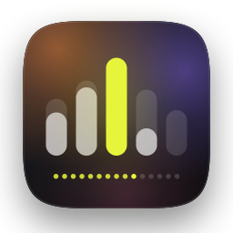
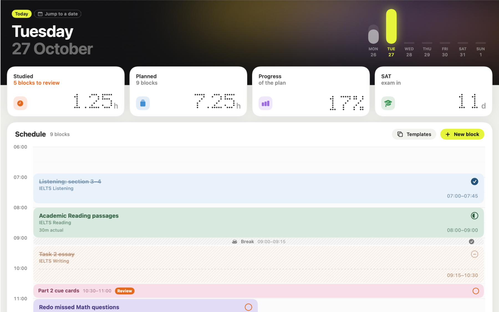
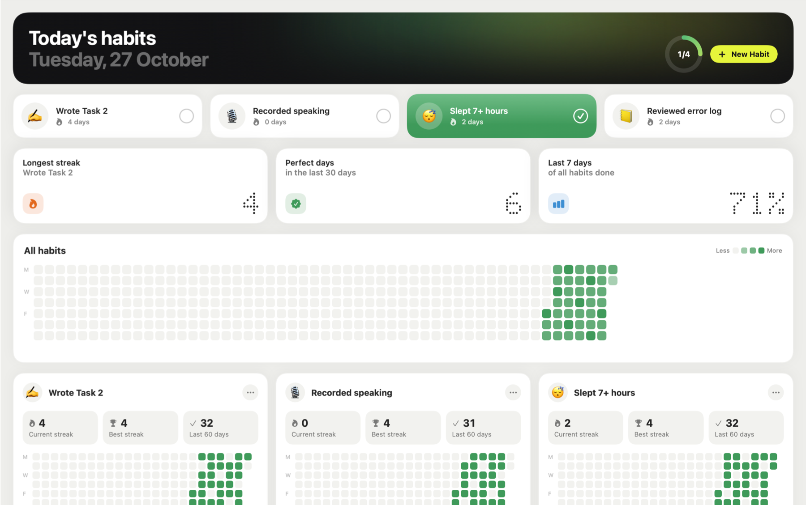
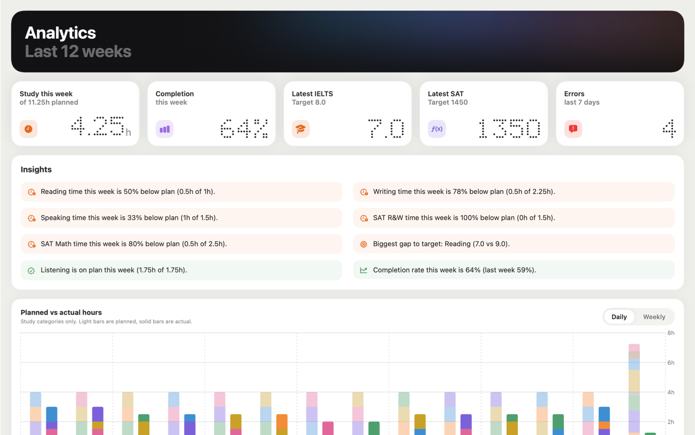
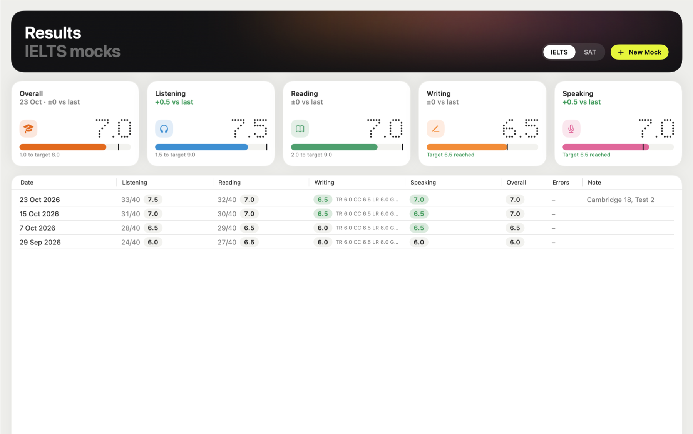
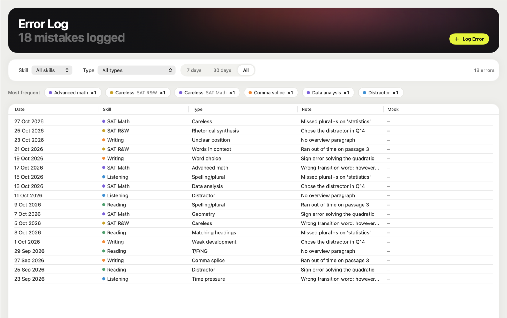

# PrepPlanner

**A native macOS study planner for IELTS and SAT: plan your day, track habits, log mistakes, watch your scores move.**

[**Download the latest release**](../../releases/latest)

| | |
|---|---|
|  |  |
|  |  |

## What it does

- **Planner** — drag on the timeline to add study blocks, mark them done, partial or skipped, and reuse whole days as templates.
- **Habits** — a daily checklist with streaks and heatmaps.
- **Results** — IELTS raw scores turn into bands automatically; SAT sections add up to a total, always measured against your target.
- **Error Log** — every mistake with its skill and type, so the patterns show.
- **Analytics** — planned vs actual hours, completion, score trends and plain-language insights.

Reminders before each block, a menu bar timer, JSON backup, English and Uzbek. Everything stays on your Mac.

## Install

Download `PrepPlanner.dmg` from [Releases](../../releases/latest) and drag the app to Applications.
The app is not notarized, so on first launch click **Done**, then **System Settings ▸ Privacy & Security ▸ Open Anyway**.

Or build it yourself: open `PrepPlanner.xcodeproj` in Xcode 16+ and press ⌘R. Tests, strings, icon and
installer scripts are described in [docs/DEVELOPMENT.md](docs/DEVELOPMENT.md).

## Contact

[github.com/mahmudulashev](https://github.com/mahmudulashev) · [mahmud@ulashev.uz](mailto:mahmud@ulashev.uz)

[MIT License](LICENSE)
